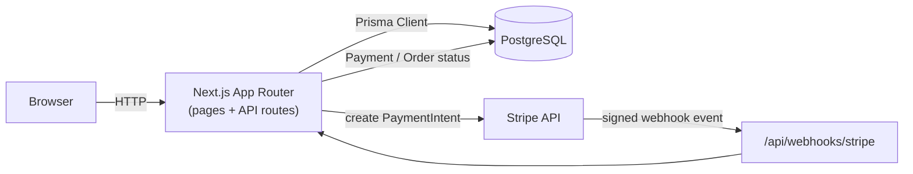

# Commerce Core

A modular-monolith e-commerce storefront built with Next.js 15, Prisma 7, and Stripe — product catalog, cart, checkout, customer accounts, and an asynchronous, webhook-driven payment lifecycle.

[](https://nextjs.org/)
[](https://www.typescriptlang.org/)
[](https://www.postgresql.org/)
[](https://stripe.com/)
[](https://vercel.com/)

## Live Demo

**[commerce-core-sigma.vercel.app](https://commerce-core-sigma.vercel.app)**

## Screenshots

| Home | Catalog |
| --- | --- |
|  |  |

| Product | Cart / Checkout |
| --- | --- |
|  |  |

| Account |
| --- |
|  |

## Overview

Commerce Core is a storefront built to show how a real checkout and payment system is actually engineered, not just assembled from a template: a typed domain model, repository boundaries, atomic database-level concurrency control, and a webhook integration that survives duplicate and concurrent delivery — the parts of e-commerce that are easy to fake and easy to get subtly wrong.

The product scope is intentionally a classic storefront (browse → cart → checkout → pay → view orders); the engineering focus is on correctness under concurrency and failure, not breadth of features.

## Key Features

- **Locale-aware storefront routing** — every page lives under a `[locale]` segment via `next-intl`; the app ships with English today and is structured to add more locales without route changes.
- **Product catalog** — categories and products with per-locale translations, a Homepage "Featured Products" section backed by real catalog data.
- **Cart → Checkout → Order** — server-side price/total calculation (never trusts client-sent amounts), guest checkout, and idempotent order submission via an `Idempotency-Key` header so a retried request can't create a duplicate order.
- **Customer accounts** — registration and login via Auth.js (NextAuth v5, credentials provider, JWT sessions), a protected account area, and an order history/detail view scoped strictly to the signed-in customer.
- **Stripe payment foundation** — a provider-agnostic `PaymentProvider` port with a Stripe adapter: PaymentIntent creation with idempotency keys, reconciliation against Stripe when the native idempotency window may have lapsed, and integrity checks that refuse a PaymentIntent whose amount/currency no longer matches the authoritative order.
- **Asynchronous payment lifecycle** — a signature-verified `POST /api/webhooks/stripe` endpoint that turns Stripe's webhook events into Payment/Order state transitions, deduplicated at the database level so retried or concurrently-delivered events can never double-process.

> The checkout flow currently creates and confirms the Order; the customer-facing "enter your card" UI that drives a PaymentIntent to completion is the next roadmap item — see [Roadmap](#roadmap).

## Tech Stack

| Layer | Technology |
| --- | --- |
| Language | TypeScript |
| Framework | Next.js 15 (App Router) |
| UI | React 19, Tailwind CSS 4 |
| Database | PostgreSQL, Prisma 7 |
| Auth | NextAuth v5 (Auth.js), credentials + JWT sessions |
| Payments | Stripe (PaymentIntents + Webhooks) |
| i18n | next-intl |
| Package manager | pnpm |
| Hosting | Vercel |
| Testing | Vitest |

## Architecture

Commerce Core is a **modular monolith**: one deployable app, split into self-contained domain modules (`catalog`, `cart`, `checkout`, `order`, `payment`, `identity`), each exposing a single public entry point (`index.ts`) and internally layered into `domain` (framework-free business rules) → `application` (use cases) → `repositories` (interfaces) → `infrastructure` (Prisma implementations). Client Components never import server-only infrastructure directly.



More detail: [docs/02-architecture](docs/02-architecture) · architecture decisions: [docs/adr](docs/adr).

## Engineering Highlights

- **Database-enforced concurrency, not application locks.** Every status transition (`Order.status`, `Payment.status`) is written with a conditional `WHERE id = ? AND status = ?` update — two concurrent callers can both read the same state, but only one write ever applies, proven with genuine `Promise.all` tests against a real Postgres instance rather than mocked timing.
- **Stripe idempotency beyond the native retention window.** Stripe only guarantees an idempotency key for a limited window; the adapter tracks when a payment attempt was first durably claimed and, once that window may have lapsed, reconciles via Stripe's Search API instead of blindly retrying `create` — treating an inconclusive search result as "unsafe to create," never as proof it's safe.
- **Webhook idempotency via a unique constraint, not a read-then-write check.** Every processed Stripe event is recorded with a `(provider, providerEventId)` database uniqueness constraint, so duplicate or genuinely concurrent webhook deliveries collide at the database layer instead of racing in application code.
- **Payment integrity is one rule, applied everywhere.** Whether a PaymentIntent is resolved via creation, retrieval, or reconciliation search, the same validation function checks it's still live and that its amount/currency match the authoritative order — Stripe is treated as evidence of external state, never as a source of truth for internal money values.
- **No cross-module database transactions, by design.** Payment and Order are separate modules with separate Prisma clients; rather than leak a shared transaction across that boundary, each side's transition is independently atomic and safe to retry, so a partial failure self-heals on Stripe's automatic webhook retry instead of corrupting state.

## Getting Started

### Prerequisites

- Node.js (compatible with Next.js 15)
- pnpm
- A PostgreSQL database (e.g. [Neon](https://neon.tech/))
- A [Stripe](https://stripe.com/) account (test mode) for payment-related features
- [Stripe CLI](https://docs.stripe.com/stripe-cli) (optional, for forwarding webhooks locally)

### Setup

```bash
pnpm install
cp .env.example .env.local
```

Fill in `.env.local` with the following variables (see `.env.example` for details — never commit real values):

| Variable | Purpose |
| --- | --- |
| `DATABASE_URL` | PostgreSQL connection string |
| `AUTH_SECRET` | Auth.js session signing secret |
| `STRIPE_SECRET_KEY` | Stripe test-mode secret key |
| `STRIPE_WEBHOOK_SECRET` | Signing secret for `/api/webhooks/stripe` |
| `SEED_ALLOW_BROAD_WRITE` | Optional — required only to run the broad demo seed script |

```bash
pnpm exec prisma migrate dev     # apply the database schema
pnpm exec tsx prisma/seed.ts     # optional: seed demo catalog data (requires SEED_ALLOW_BROAD_WRITE)
pnpm dev                         # start the app at localhost:3000
```

To receive Stripe webhooks locally:

```bash
stripe listen --forward-to localhost:3000/api/webhooks/stripe
```

## Project Structure

```
src/
  app/              # Next.js App Router: [locale] pages + api/ routes
  modules/          # Domain modules — catalog, cart, checkout, order, payment, identity
    <module>/
      domain/          # Entities and business rules (framework-free)
      application/     # Use cases / orchestration
      repositories/    # Repository interfaces
      infrastructure/  # Prisma implementations, external clients
      presentation/    # Server Components
      components/      # Client Components
  core/             # Auth (Auth.js), i18n, shared config
prisma/             # Schema, migrations, seed scripts
docs/               # Architecture, ADRs, roadmap
```

## Roadmap

Full roadmap: [docs/roadmap](docs/roadmap/Roadmap.md)

Next up:

- Customer-facing payment UI that drives a Stripe PaymentIntent to completion (the checkout flow currently stops at order creation)
- Refunds and order cancellation
- Admin catalog and order management
- Product search
- Order status history / audit log

## Author

**Yevhenii Leonov**
GitHub: [github.com/Leonov22](https://github.com/Leonov22)
LinkedIn: _TODO_

## License

[MIT](LICENSE)
